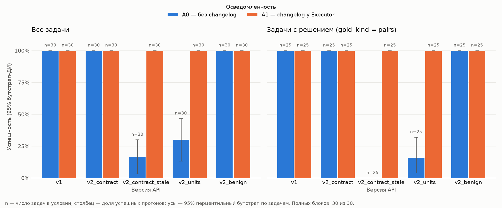

# Анализ эксперимента `main` (gemini)

Сгенерировано 2026-10-26 14:54 UTC; источник: завершённые трассы `D:\ITMO\AIST\T11\runs\main\gemini\traces`.

**Полных блоков (задача во всех 10 условиях сетки): 30** из 30 начатых; завершённых прогонов всего: 300.

В статистику включены только полные блоки: **300** прогонов; исключено прогонов из неполных блоков: 0. Все неполные — флаг `--include-partial`.

n по условиям: `v1:A0` = 30, `v1:A1` = 30, `v2_contract:A0` = 30, `v2_contract:A1` = 30, `v2_contract_stale:A0` = 30, `v2_contract_stale:A1` = 30, `v2_units:A0` = 30, `v2_units:A1` = 30, `v2_benign:A0` = 30, `v2_benign:A1` = 30

## 1. Успешность по условиям

Бутстрап 95% ДИ: 10000 ресемплов по задачам, seed 20261023. «С решением» — только `gold_kind = pairs`: на задачах без решения наивный агент при v2_units «угадывает» no_option.

| Условие | n (все) | Успех (все) | n (с решением) | Успех (с решением) |
|---|---|---|---|---|
| `v1:A0` | 30 | 100% [100%–100%] | 25 | 100% [100%–100%] |
| `v1:A1` | 30 | 100% [100%–100%] | 25 | 100% [100%–100%] |
| `v2_contract:A0` | 30 | 100% [100%–100%] | 25 | 100% [100%–100%] |
| `v2_contract:A1` | 30 | 100% [100%–100%] | 25 | 100% [100%–100%] |
| `v2_contract_stale:A0` | 30 | 17% [3%–30%] | 25 | 0% [0%–0%] |
| `v2_contract_stale:A1` | 30 | 100% [100%–100%] | 25 | 100% [100%–100%] |
| `v2_units:A0` | 30 | 30% [13%–47%] | 25 | 16% [4%–32%] |
| `v2_units:A1` | 30 | 100% [100%–100%] | 25 | 100% [100%–100%] |
| `v2_benign:A0` | 30 | 100% [100%–100%] | 25 | 100% [100%–100%] |
| `v2_benign:A1` | 30 | 100% [100%–100%] | 25 | 100% [100%–100%] |



## 2. Парные сравнения по задачам

Точный тест Макнемара (биномиальный по несогласованным парам). ✓→✗ — задача, пройденная в базовом условии и проваленная в сравниваемом. Поправка Холма — внутри каждого семейства сравнений и подмножества задач.

### а) эффект изменения API (v2_*:A0 против v1:A0) — все задачи

| База → сравнение | n пар | оба ✓ | ✓→✗ | ✗→✓ | оба ✗ | Успех база → сравн. | p | p (Холм) |
|---|---|---|---|---|---|---|---|---|
| `v1:A0` → `v2_contract:A0` | 30 | 30 | 0 | 0 | 0 | 100% → 100% | 1.000 | 1.000 |
| `v1:A0` → `v2_contract_stale:A0` | 30 | 5 | 25 | 0 | 0 | 100% → 17% | <0.001 | <0.001 |
| `v1:A0` → `v2_units:A0` | 30 | 9 | 21 | 0 | 0 | 100% → 30% | <0.001 | <0.001 |
| `v1:A0` → `v2_benign:A0` | 30 | 30 | 0 | 0 | 0 | 100% → 100% | 1.000 | 1.000 |

### б) эффект changelog (A1 против A0 внутри версии) — все задачи

| База → сравнение | n пар | оба ✓ | ✓→✗ | ✗→✓ | оба ✗ | Успех база → сравн. | p | p (Холм) |
|---|---|---|---|---|---|---|---|---|
| `v1:A0` → `v1:A1` | 30 | 30 | 0 | 0 | 0 | 100% → 100% | 1.000 | 1.000 |
| `v2_contract:A0` → `v2_contract:A1` | 30 | 30 | 0 | 0 | 0 | 100% → 100% | 1.000 | 1.000 |
| `v2_contract_stale:A0` → `v2_contract_stale:A1` | 30 | 5 | 0 | 25 | 0 | 17% → 100% | <0.001 | <0.001 |
| `v2_units:A0` → `v2_units:A1` | 30 | 9 | 0 | 21 | 0 | 30% → 100% | <0.001 | <0.001 |
| `v2_benign:A0` → `v2_benign:A1` | 30 | 30 | 0 | 0 | 0 | 100% → 100% | 1.000 | 1.000 |

### а) эффект изменения API (v2_*:A0 против v1:A0) — с решением

| База → сравнение | n пар | оба ✓ | ✓→✗ | ✗→✓ | оба ✗ | Успех база → сравн. | p | p (Холм) |
|---|---|---|---|---|---|---|---|---|
| `v1:A0` → `v2_contract:A0` | 25 | 25 | 0 | 0 | 0 | 100% → 100% | 1.000 | 1.000 |
| `v1:A0` → `v2_contract_stale:A0` | 25 | 0 | 25 | 0 | 0 | 100% → 0% | <0.001 | <0.001 |
| `v1:A0` → `v2_units:A0` | 25 | 4 | 21 | 0 | 0 | 100% → 16% | <0.001 | <0.001 |
| `v1:A0` → `v2_benign:A0` | 25 | 25 | 0 | 0 | 0 | 100% → 100% | 1.000 | 1.000 |

### б) эффект changelog (A1 против A0 внутри версии) — с решением

| База → сравнение | n пар | оба ✓ | ✓→✗ | ✗→✓ | оба ✗ | Успех база → сравн. | p | p (Холм) |
|---|---|---|---|---|---|---|---|---|
| `v1:A0` → `v1:A1` | 25 | 25 | 0 | 0 | 0 | 100% → 100% | 1.000 | 1.000 |
| `v2_contract:A0` → `v2_contract:A1` | 25 | 25 | 0 | 0 | 0 | 100% → 100% | 1.000 | 1.000 |
| `v2_contract_stale:A0` → `v2_contract_stale:A1` | 25 | 0 | 0 | 25 | 0 | 0% → 100% | <0.001 | <0.001 |
| `v2_units:A0` → `v2_units:A1` | 25 | 4 | 0 | 21 | 0 | 16% → 100% | <0.001 | <0.001 |
| `v2_benign:A0` → `v2_benign:A1` | 25 | 25 | 0 | 0 | 0 | 100% → 100% | 1.000 | 1.000 |

## 3. Провалы и операционные метрики

Доля ошибок инструментов = ошибочные результаты / все вызовы инструментов условия.

| Условие | n | Причины провалов | Доля ошибок инстр. | Прогонов с ошибкой | Лимит шагов | LLM-вызовов/прогон | Токенов/прогон | cache_hits/прогон | json_fenced |
|---|---|---|---|---|---|---|---|---|---|
| `v1:A0` | 30 | — | 0% | 0 | 0 | 4.0 | 3471 | 1.8 | 17 |
| `v1:A1` | 30 | — | 0% | 0 | 0 | 4.0 | 3625 | 1.2 | 22 |
| `v2_contract:A0` | 30 | — | 0% | 0 | 0 | 4.0 | 3561 | 1.0 | 17 |
| `v2_contract:A1` | 30 | — | 0% | 0 | 0 | 4.0 | 3719 | 0.8 | 18 |
| `v2_contract_stale:A0` | 30 | false_no_option: 25 | 80% | 30 | 4 | 7.3 | 7911 | 1.8 | 1 |
| `v2_contract_stale:A1` | 30 | — | 0% | 0 | 0 | 4.0 | 3635 | 1.2 | 19 |
| `v2_units:A0` | 30 | false_no_option: 21 | 0% | 0 | 0 | 4.0 | 3474 | 1.5 | 13 |
| `v2_units:A1` | 30 | — | 0% | 0 | 0 | 4.0 | 3632 | 0.9 | 14 |
| `v2_benign:A0` | 30 | — | 0% | 0 | 0 | 4.0 | 3822 | 1.0 | 21 |
| `v2_benign:A1` | 30 | — | 0% | 0 | 0 | 4.0 | 3962 | 1.0 | 17 |

## 4. «Понял, но не сделал»

Эвристика по тексту финального отчёта Executor (без LLM).
- `v2_contract_stale:A0`: отчёт упоминает `num_nights` или несовпадение схемы, а вызова с `num_nights` не было ни разу.
- `v2_units:A0`: отчёт упоминает центы / minor units / неверные единицы, а цены в отчёте или финальном ответе остались непереведёнными (совпадают с сырыми ценами инструмента).

### Провалы `v2_contract_stale:A0`

| Показатель | Прогонов |
|---|---|
| Провалов условия | 25 |
| Отчёт упоминает `num_nights` | 21 |
| Отчёт упоминает схему / несовпадение | 10 |
| Был вызов с `num_nights` | 0 |
| **Понял, но не сделал** | 21 |
| Нет отчёта (лимит шагов) | 2 |

Примеры отчётов:

- T02: ```json {   "hotels": [],   "flights": [     {"id": "F1501", "price_usd": 173.86},     {"id": "F1585", "price_usd": 177.76},     {"id": "F1850", "price_usd": 347.46}   ],   "best": null,   "notes": "Hotel search tool failed due to schema va
- T03: ```json {"hotels": [],  "flights": [{"id": "F1729", "price_usd": 365.44}],  "best": null,  "notes": "Hotel search failed due to API parameter error (num_nights required instead of nights)."} ```
- T05: ```json {   "hotels": [],   "flights": [     {"id": "F1261", "price_usd": 265.38},     {"id": "F1721", "price_usd": 349.9}   ],   "best": null,   "notes": "Hotel search failed due to parameter validation error (num_nights required instead o

### Провалы `v2_units:A0`

| Показатель | Прогонов |
|---|---|
| Провалов условия | 21 |
| Отчёт упоминает центы / единицы | 10 |
| Цены не переведены | 21 |
| **Понял, но не сделал** | 10 |
| Нет отчёта (лимит шагов) | 0 |

Примеры отчётов:

- T05: ```json {   "hotels": [     {"id": "H154", "price_usd": 29340.0},     {"id": "H174", "price_usd": 87828.0},     {"id": "H128", "price_usd": 126336.0}   ],   "flights": [     {"id": "F1261", "price_usd": 26538.0},     {"id": "F1721", "price_
- T08: ```json {   "hotels": [     {"id": "H154", "price_usd": 24450.0},     {"id": "H174", "price_usd": 73190.0},     {"id": "H128", "price_usd": 105280.0}   ],   "flights": [     {"id": "F1540", "price_usd": 18570.0},     {"id": "F1627", "price_
- T10: ```json {   "hotels": [     {"id": "H139", "price_usd": 16218},     {"id": "H152", "price_usd": 16218},     {"id": "H104", "price_usd": 23622}   ],   "flights": [     {"id": "F1469", "price_usd": 18568},     {"id": "F1421", "price_usd": 201
